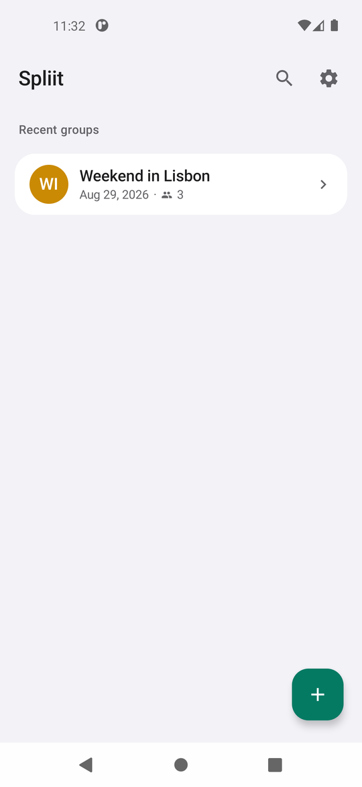
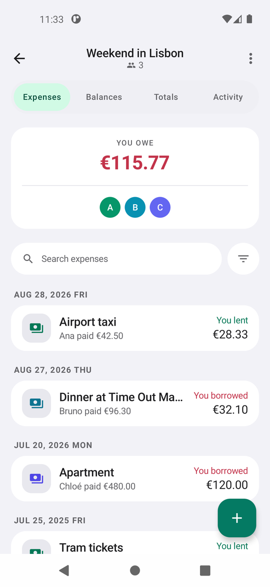
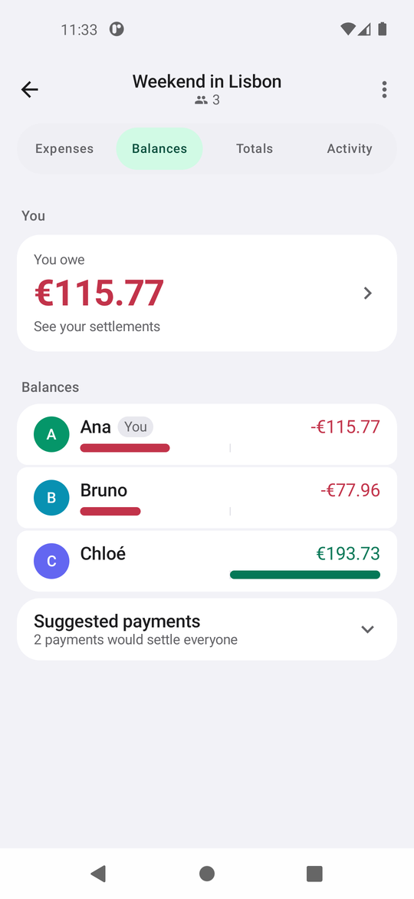
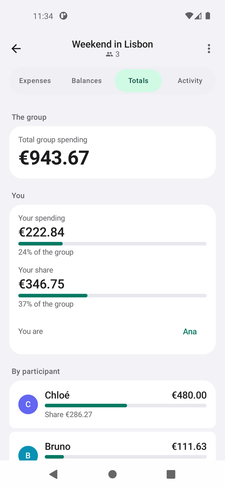

# Spliit for Android

An Android client for [Spliit](https://spliit.app) — the free, open-source
[Splitwise](https://www.splitwise.com) alternative — written in Kotlin with Jetpack Compose on
Material 3 Expressive.

There are no accounts, no analytics and no backend of its own: a group lives on the Spliit
instance its link points at, and the app is one more member of that group, reading and writing the
same data through the instance's tRPC API. Point it at `https://spliit.app`, or at a Spliit server
you run yourself.

It began as a 1:1 port of the iOS app ([spliit-app/spliit-ios](https://github.com/spliit-app/spliit-ios)),
which remains the reference for behaviour and layout, against the web app's own API
([spliit-app/spliit](https://github.com/spliit-app/spliit)).

## Screens

Captured on the API 30 emulator against the fake instance in `tools/fake-spliit`.

| | |
|:---:|:---:|
|  |  |
| **Groups** — every group, the ones you starred first | **Expenses** — a group's spending by day, who paid, and what each row means for you |
|  |  |
| **Balances** — what everyone is owed or owes, and the fewest payments that settle it | **Totals** — what the group spent, your own part of it, and the breakdown by participant |

## Features

### Groups

- [x] Create a group — name, currency (with a custom symbol if you need one), participants
- [x] Join an existing group by its link, or paste one from a shared message
- [x] Star a group to keep it at the top of the list
- [x] Archive a group and bring it back
- [x] Search your groups
- [x] Share the group link, or copy it
- [x] Edit the group's name and currency, and delete it
- [x] Import and export expenses as CSV in Splitwise's format

### Expenses

- [x] Add an expense — description, amount, date, payer, category and subcategory
- [x] Split four ways: **Evenly**, **By amount**, **By shares**, **By percentage**
- [x] Select all or none of the participants at once, and save a split as the default
- [x] Mark an expense as a reimbursement
- [x] Notes on an expense
- [x] Attach photos of a receipt, taken with the camera or picked from storage
- [x] Edit and delete an expense, with an undo bar for a deletion
- [x] Search a group's expenses, and filter the list by who paid

### Who owes whom

- [x] Balances for every participant — who is owed, who owes, and how much
- [x] Suggested payments that settle a group in the fewest transfers
- [x] Mark a settlement as paid, and see your own settlements
- [x] Pick your name, so the group knows which balance is yours

### Totals

- [x] Group spending and earnings, your own spending and earnings, and your balance
- [x] A breakdown by category and by participant, adding up to the group totals

### Activity

- [x] A log of what changed in the group, and who changed it

### Without a network

- [x] Every group page is read from a saved copy when the instance cannot be reached
- [x] Edits made offline are kept and sent when a connection comes back
- [x] Queued expenses appear in the list, the totals and search, marked **Waiting to send**

### The app itself

- [x] Material 3 Expressive, with skeletons rather than spinners while a page loads
- [x] Light, dark, or follow the system
- [x] Material You colours from the wallpaper on Android 12+, or one of four app palettes — Iris,
      Lagoon, Ember, Meadow — or Spliit's own emerald palette
- [x] Adaptive launcher icon

### Not in this app

| Feature | Why |
| --- | --- |
| **AI receipt scanning** (fill an expense from a photo) | Spliit's `ENABLE_RECEIPT_EXTRACT` needs an OpenAI key from whoever runs the instance. The app never asks for a key and never ships a model call. Attaching a photo of a receipt works; reading the numbers off it does not. |
| **Accounts, sign-in, sync between devices** | Spliit has no accounts. A group link *is* the access, and the instance is the only copy of the data. |
| **Translations** | English only for now. |
| **Splitwise import** | The CSV export Splitwise produces is imported, but there is no connected Splitwise account to sign into. |

## What the app needs from the server

Any Spliit instance, including `https://spliit.app` and a self-hosted one. Some features depend on
how that instance is configured:

| On the instance | In the app |
| --- | --- |
| Nothing in particular | Groups, expenses, balances, settling, activity, CSV |
| A recent version (the statistics procedures) | The Totals tab — an older instance answers "No totals on this server" |
| `ENABLE_EXPENSE_DOCUMENTS` with `S3_UPLOAD_*` | Attaching receipt photos. Without it the app says the server doesn't accept them, rather than blaming the network |
| `ENABLE_RECEIPT_EXTRACT` + `OPENAI_API_KEY` | **Not used.** See above. |

The release build talks HTTPS only. A plain-`http://` development instance is reachable from the
**debug** build alone; see [`docs/LOCAL_TESTING.md`](docs/LOCAL_TESTING.md).

## Compatibility

- `minSdk = 26` (Android 8.0), `targetSdk = 36`, `compileSdk = 36`
- Core library desugaring for `java.time`
- No Android 12+ only APIs; dynamic colour is used where it exists and a palette fills in where it
  does not
- The release APK is about 2.3 MB

## Install on a phone

`minSdk = 26`, so any phone on Android 8.0 or newer runs it. Download the APK from
[Releases](https://github.com/emilshain/spliit-android/releases), or build it yourself below.

Install with the phone plugged in and USB debugging on (Developer options → USB debugging):

```sh
adb devices                  # confirm the phone is listed and authorised
adb install -r spliit-0.1.0-release.apk
```

Without adb — copy the file over (USB file transfer, cloud drive, email) and tap it in
**Files → Downloads**, allowing "install unknown apps" for the Files app when prompted. Play
Protect may ask to scan a sideloaded app first; that is normal.

Two things to know:

- A debug build and a release build are signed with different keys, so one will not install over
  the other (`INSTALL_FAILED_UPDATE_INCOMPATIBLE`). Uninstall first.
- Only the debug build can reach a plain-`http://` instance.

### Build the APK

The local scripts build, align and sign it in one step. They are git-ignored because they carry
this machine's tool paths:

```sh
bash run-local.sh apk         # dist/spliit-0.1.0-release.apk, for spliit.app groups
bash run-local.sh apk debug   # dist/spliit-0.1.0-debug.apk, for a local http server
```

Or double-click `make-apk.cmd` (and `make-apk.cmd debug` for the debug build).

By hand:

```sh
export JAVA_HOME="C:/Users/EmilShain/Code/spliit-workspace/.tooling/jdk21"
export ANDROID_HOME="C:/Users/EmilShain/Code/spliit-workspace/.tooling/sdk"

./gradlew :app:assembleRelease

BT="$ANDROID_HOME/build-tools/35.0.0"
KS="C:/Users/EmilShain/Code/spliit-workspace/.tooling/keys/spliit-test.jks"

mkdir -p dist
"$BT/zipalign.exe" -f -p 4 app/build/outputs/apk/release/app-release-unsigned.apk dist/aligned.apk
"$BT/apksigner.bat" sign --ks "$KS" --ks-key-alias spliit \
  --ks-pass pass:spliitdev --key-pass pass:spliitdev \
  --out dist/spliit-0.1.0-release.apk dist/aligned.apk
rm dist/aligned.apk
```

The `.exe` / `.bat` suffixes are not optional in Git Bash: `apksigner` on its own is not found, and
an unsigned APK will not install. The release is signed with the local test key in
`../.tooling/keys/spliit-test.jks`, which is a throwaway rather than a Play-ready key — keep that
keystore if later builds should upgrade over this one.

## Toolchain

Everything builds from the workspace without a system-wide SDK install:

| Component | Version | Location |
|---|---|---|
| JDK | Temurin 21 | `../.tooling/jdk21` (via `org.gradle.java.home`) |
| Android SDK | platform 36, build-tools 35.0.0 | `../.tooling/sdk` (via `local.properties`) |
| Gradle | 8.13 (wrapper) | `./gradlew` |
| AGP / Kotlin | 8.13.2 / 2.3.21 | `build.gradle.kts` |
| Compose BOM / Material 3 | 2026.06.01 / 1.4.0 | `app/build.gradle.kts` |

```sh
./gradlew :app:assembleDebug
```

`org.gradle.java.home` only applies to the build daemon, so a shell whose default JDK is not 21
must also export the launcher's JDK:

```sh
export JAVA_HOME="C:/Users/EmilShain/Code/spliit-workspace/.tooling/jdk21"
export ANDROID_HOME="C:/Users/EmilShain/Code/spliit-workspace/.tooling/sdk"
```

`local.properties` is git-ignored; a fresh clone needs its own `sdk.dir`.

## Testing

```sh
./gradlew :app:testDebugUnitTest :app:assembleDebug -Dspliit.skipLive=true
```

`-Dspliit.skipLive=true` skips the tests that talk to the real `spliit.app`. Everything else runs on
the JVM: the logic as plain unit tests, and the screens rendered by Robolectric. `ExpenseListTabTest`
has a known flake in the full suite (a `ComposeTimeoutException`) and passes on its own.

## Running it against a local instance

`bash run-local.sh` boots an emulator and a fake Spliit instance built from the test fixtures, then
builds, installs and launches the app against it. The manual equivalent, and the gotchas that cost
time the first run, are in [`docs/LOCAL_TESTING.md`](docs/LOCAL_TESTING.md).

```sh
node tools/fake-spliit/server.mjs     # http://0.0.0.0:8790
# then, in the app: Add by link →
# http://10.0.2.2:8790/groups/sh__QL0eGqn-fw98LhAtW
```

`tools/fake-spliit/` answers the procedures the app uses — groups, expenses (with search), balances,
statistics, activity, categories — and the document upload handshake (`/api/s3-upload` plus
`/uploads`), so a receipt photo can be attached and viewed without touching real object storage.

## Documentation

| File | What is in it |
| --- | --- |
| `README.md` | This: what the app is, what it does, how to build and install it |
| [`AGENTS.md`](AGENTS.md) | How to work on the code: UI conventions, motion, colour roles, offline, receipts, tests |
| [`docs/AUDIT.md`](docs/AUDIT.md) | The audit of the iOS app this port follows: design tokens, API contract, screens |
| [`docs/LOCAL_TESTING.md`](docs/LOCAL_TESTING.md) | Emulator, fake instance, and how to drive the app from the command line |

## Related projects

- [spliit-app/spliit](https://github.com/spliit-app/spliit) — the web app and the API this talks to
- [spliit-app/spliit-ios](https://github.com/spliit-app/spliit-ios) — the iOS app this ports
- [sharneng/spliit2go](https://github.com/sharneng/spliit2go) — an independent Flutter client

The workspace this repo is developed in keeps read-only clones of those beside it, which is where
the layout, palette and API details were read from:

```
spliit-workspace/
  ref-spliit-ios/    # SwiftUI reference (UI + logic source of truth)
  ref-spliit-web/    # Next.js backend (tRPC contract + Prisma schema)
  ref-spliit2go/     # independent Flutter client (second opinion on the API)
  spliit-android/    # this repository
```

## Licence

Spliit itself is MIT-licensed — see the web repository's `LICENSE`. This client does not carry its
own licence file yet.
